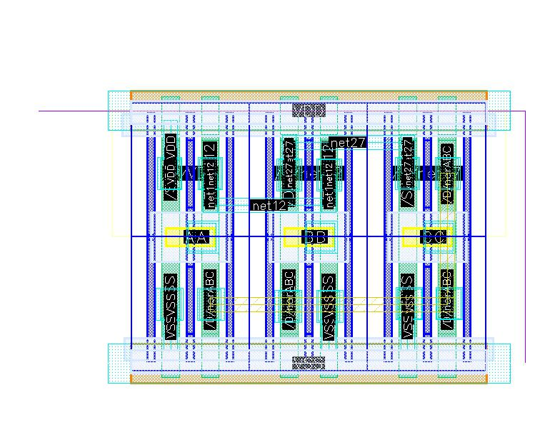

# NOR3 gate — custom FinFET schematic and layout

Three-input CMOS NOR gate developed at the University of Minnesota using the TSMC N16 FinFET environment, with Cadence schematic/layout work, HSPICE test decks, and saved physical-verification screenshots.

The netlist implements **Y = NOT(A OR B OR C)** using three parallel NMOS devices and three series PMOS devices. The selected netlist specifies 16 nm device length and four fins per device.

## Design and evidence



| File | Purpose |
|---|---|
| `spice/nor3.sp` | Six-device transistor-level netlist |
| `spice/run_nor3.sp` | NOR3 simulation deck |
| `spice/run_nor3_fo4.sp` | NOR3 deck driving four inverter inputs |
| `spice/inv_subckt.sp` | Inverter wrapper used by the FO4 deck |
| `native/nor3-cadence-library.zip` | Native cell/view data, including schematic and layout variants |

The FO4 deck specifies 0.8 V, 70 °C, the TT model section, pulsed inputs, and a 2 ns transient simulation. No stored `.mt0` measurement file was present, so no numerical propagation-delay result is claimed here.

## Physical verification evidence

The report's [LVS comparison screenshot](images/lvs-comparison.png) marks the NOR3 cell **CORRECT**, with six layout/source ports, eight nets, and six transistor instances on each side.

The [cell DRC screenshot](images/drc-cell.png) shows zero displayed results under the **Show Not Waived** filter, out of 48 results. This documents a waiver-based result, not an unqualified zero-violation claim.

The [3 × 3 grid DRC screenshot](images/drc-grid.png) shows **117 results across eight checks**, so array-level DRC issues remain. Screenshots were extracted unchanged from the supplied report; standalone Calibre result databases/reports are not included.

## Rerunning

Requires licensed HSPICE and access to the external TSMC N16 model library. Configure the `.lib` paths, then run from `spice/`:

```sh
hspice -i run_nor3_fo4.sp -o rerun_nor3_fo4
```

The native archive preserves cell/view hierarchy. Configure the library and technology bindings in a compatible Cadence environment before opening it. External model libraries and Calibre rule decks are not included.

This repository preserves the supplied design files and selected report images. No HSPICE, Cadence, or Calibre run was performed during repository preparation. Waveforms and full reports remain in the original upload.
