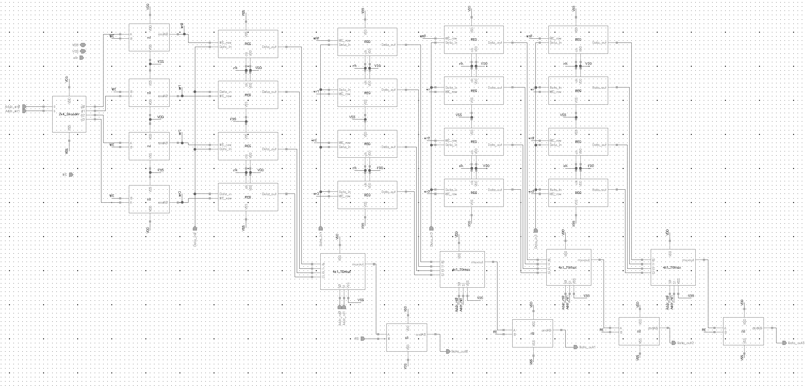

# 4 × 4 DFF register file — transistor-level FinFET design

A 16-bit register file arranged as four 4-bit words, designed at the University of Minnesota in the TSMC N16 FinFET environment.

The hierarchy combines C2MOS D flip-flops, feedback/input multiplexers, a 2-to-4 write decoder, write-enable gating, 4-to-1 read multiplexers, and read-enable gating. The archive contains block-level and integrated HSPICE netlists, read/write test decks, and saved measurements.



## Stored timing measurements

The following values come directly from integrated `.mt0` records. They describe specific trigger/target experiments.

| Record in `spice/4x4RF/` | Measurement | Saved value |
|---|---|---:|
| `run_4x4RF.mt0` | `t_re_to_dout1`, `t_re_to_dout3` | 6.341 ps each |
| `run_4x4RF_BCT.mt0` | `t_clk_to_net43` | 17.64 ps |
| `run_4x4RF_SlowWrite.mt0` | Four named clock-to-internal-node measures | 39.58 ps each |

The corresponding decks use 0.8 V and 25 °C; the SlowWrite deck selects the SS model section, while the main and BCT decks select TT.

**Source/result caveat:** the saved SlowWrite measurement headers name net49/net20/net1/net13, whereas the current SlowWrite deck measures net37. The report also describes a 19.89 ps write result. These artifacts do not establish one matched final write-delay result. They remain separate experiments requiring a matched rerun.

Component measurement files include failed or negative delays. Their trigger/target definitions need review before using them as performance claims. The saved records do not establish exhaustive functional coverage, complete setup/hold characterization, or maximum clock frequency.

## Repository contents

- `spice/4x4RF/`: integrated circuit and read/write timing decks, with saved measurements.
- Other `spice/` subdirectories: DFF, decoder, mux, and intermediate register-file blocks; older variants retain their original names.
- `images/register-file-schematic.png`: supplied top-level schematic image.
- `native/register-file-4x4-cadence-library.zip`: native schematic/symbol cell data with original hierarchy.

The project report describes writes and reads across all addresses, overwrite/no-clock-edge scenarios, and concurrent read/write experiments. These are report-described checks; no new functional simulation was executed here.

## Rerunning

Requires licensed HSPICE and the external TSMC N16 model environment. Configure the model paths in the selected deck, then run from the integrated circuit directory:

```sh
cd spice/4x4RF
hspice -i run_4x4RF.sp -o rerun_4x4RF
```

Use distinct output prefixes to preserve archived measurements. Review the chosen deck's trigger/target nodes and source snapshot before comparing results.

For Cadence, extract the native archive and configure its library/technology bindings in a compatible environment. No PDK model library is bundled.

No fresh HSPICE or physical-verification run was performed during GitHub preparation. The subset contains design and simulation evidence; full reports and waveform binaries remain in the original upload.
